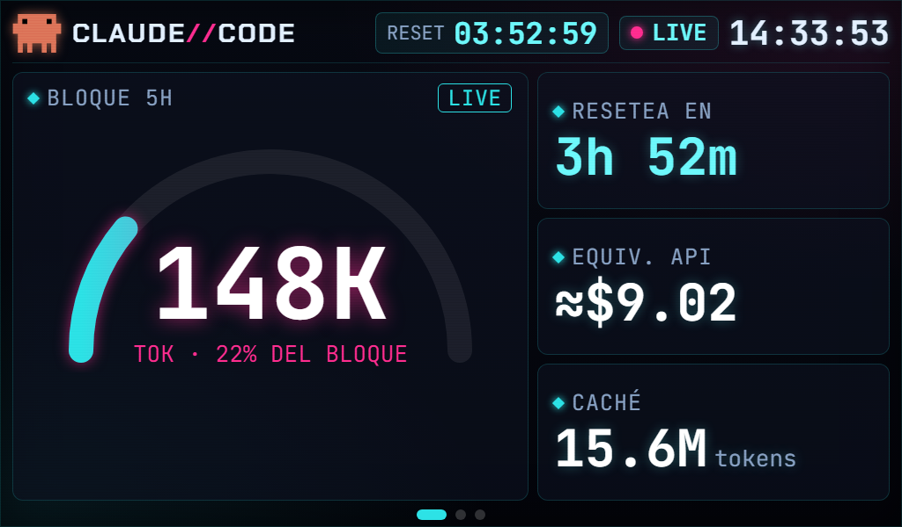

# Claude Code Telemetry

Panel de pared (Hosyond 5", 1024×600) que muestra cuánto Claude Code usas en
esta máquina: ventana de 5 h, hoy, mezcla de modelos, proyectos y los últimos
7 días. Todo sale de los logs locales de Claude Code; no hay API oficial de
consumo de suscripción.



## Cómo funciona

```
[Mac]  push.py ──┐  HTTPS + token
                 ├─► [VPS] hub.py ─► /api/telemetry ─► server.py (PC del panel) ─► HUD kiosko
[Win]  server.py ┘                                       └─ si el hub no responde: logs locales
```

- **collector.py** lee los JSONL de forma incremental (desde el último byte leído),
  **deduplica** por `message.id` + `requestId` y agrega en hora local.
  `build_snapshot` une varias máquinas: la ventana de 5 h, los totales y la mezcla
  se calculan sobre la **unión** de mensajes (la ventana es por cuenta, no por máquina).
- **push.py** (Mac, o cualquier máquina sin panel) envía los últimos 32 días de
  registros al hub, comprimidos, cada 120 s.
- **hub.py** (VPS, solo biblioteca estándar) valida y guarda el último reporte de
  cada máquina en `hub-data/` (sobrevive a reinicios) y sirve la vista unida.
  Una máquina sin reportar en 10 min aparece OFFLINE.
- **server.py** (PC del panel) sirve el HUD. Con `config.json` pide los datos al
  hub y además reporta esta máquina; si el hub no responde, muestra solo los logs
  locales y lo indica en amarillo ("HUB SIN RESPUESTA"). El token nunca llega al navegador.
- **history.db** guarda totales por día para que el histórico de 7 días sobreviva
  si Claude Code purga logs viejos.
- **launch.ps1** arranca el servidor, localiza el panel ≤1600 px, lo pone a
  1024×600 (cambio temporal, no persiste) y abre Edge/Chrome en kiosko.
  Deja un registro en `launch.log`.

## Modo multi-máquina

**1. VPS** (una vez). Con `config.json` ya creado (paso 2), ejecuta desde la PC
`bash deploy/install-vps.sh`: copia `hub.py` y `collector.py` a
`/var/www/apps/claude-dashboard`, deja el token solo en el servidor (chmod 600),
añade el `location /claude-hub/` a nginx (con backup y `nginx -t`; si falla restaura
y no recarga) y arranca el hub con pm2. Los pasos manuales equivalentes están en
`deploy/ecosystem.config.cjs` y `deploy/nginx-claude-hub.conf`. El hub se niega a
arrancar sin `CLAUDE_HUB_TOKEN` (≥ 24 caracteres).

**2. PC del panel (Windows).** Copia `config.example.json` a `config.json` con la URL
(`https://guarrod.com/claude-hub`), el mismo token y `"machine": "WIN-01"`. Al
reiniciar `server.py` verás `hub: … (reporting as WIN-01)`.

**3. Mac.** Mismo `config.json` con `"machine": "MAC-01"`. Prueba con `python3 push.py`
y déjalo corriendo con `deploy/com.claude-dashboard.push.plist` (launchd).

Seguridad: el token es un secreto compartido que da lectura y escritura. La URL
debe ser `https://` (config.py lo exige salvo localhost); `config.json` y
`hub-data/` están en `.gitignore`. El hub valida cada fila, limita el tamaño
(8 MB), el número de máquinas (8) y compara el token en tiempo constante.

## Uso

```
python server.py            # http://127.0.0.1:8787
python server.py            # el HUD se recarga solo si cambia el HTML
python server.py --no-hub   # ignora config.json: solo logs locales
python push.py [--loop 120] # reporta esta máquina al hub
CLAUDE_HUB_TOKEN=… python hub.py   # el hub (en el VPS)
python collector.py         # imprime el snapshot JSON
python -m unittest discover -s tests
dashboard.bat               # servidor + kiosko en el panel
```

## Reglas de honestidad

- **Tokens** = input + output (trabajo real). La caché (~95 % del total bruto) se
  muestra aparte.
- **`≈ $`** es el equivalente a precios de API, no un cobro. Un `*` indica que hubo
  modelos sin precio conocido (p. ej. Fable) y que el monto está incompleto.
- El arco de 5 h mide **tiempo transcurrido**, no un % de límite: Anthropic no
  publica el tope.
- Solo cuenta Claude Code de las máquinas que reportan. Chat y Design no dejan logs locales.

## Precios y modelos

`collector.py` deriva familia y etiqueta del id real del modelo (`claude-opus-4-8`
→ "Opus 4.8"). Los precios están en `_P_*`; Sonnet 5.x usa la tarifa de Sonnet
como estimación y modelos desconocidos no se valorizan.

## Notas

- `preview.png` es una captura real (una sola máquina). El HUD se dibuja a 1024×600 con texto ≥ 18 px (≈ 237 ppi en el panel de 5"): ajusta tamaños en el CSS respetando ese mínimo.
- `legacy/` contiene la versión anterior pygame/Pillow, sin mantenimiento (ya no
  funciona con el `collector.py` actual).
